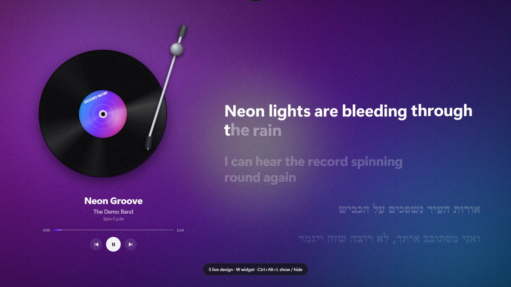
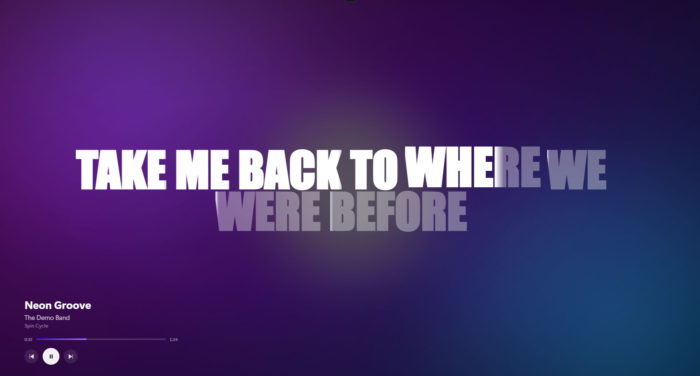
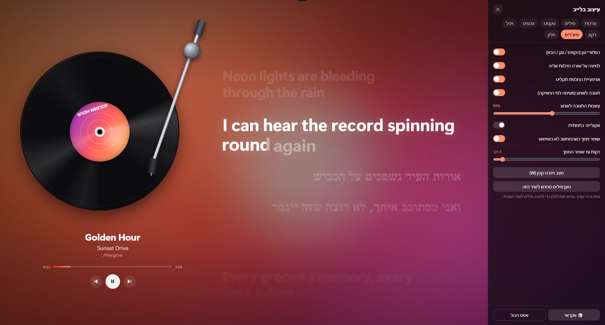
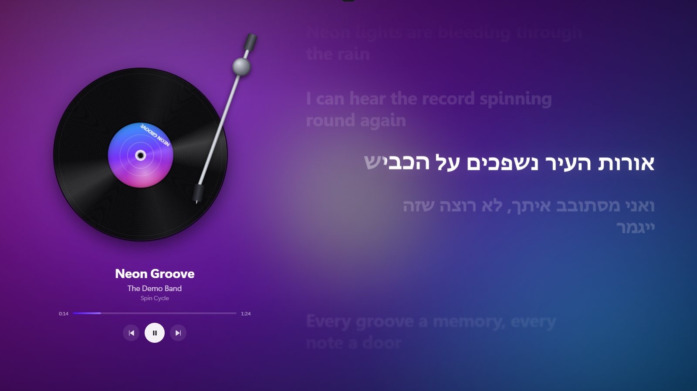
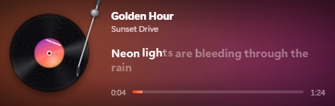

# Needledrop

**A spinning vinyl and word-by-word lyrics for Apple Music on Windows 11.**
A companion window that turns whatever is playing into a living turntable: the record spins with the album cover as its label, the tonearm follows the song, the background takes its colours from the artwork, and the lyrics light up word by word as they are sung.



> Needledrop is an independent project. It is not affiliated with, endorsed by or sponsored by Apple Inc. "Apple Music" is a trademark of Apple Inc., used here only to say which app Needledrop works with.

*(עברית בהמשך · [עבור לעברית](#עברית))*

---

## Why it exists

Apple Music for Windows is a closed Store app: nothing can be injected into it, and it has no visualiser or immersive lyrics view. Needledrop sits next to it instead. It reads what Apple Music already publishes to Windows (the media session that powers the system volume flyout), so it works with the real app, with no hack, no account and no login.

## Highlights

| | |
|---|---|
| **Real vinyl** | The cover is the record's label (or the whole disc in *picture disc* mode). Eased spin-up and spin-down, a tonearm that lifts on pause and tracks the song's progress, 3D tilt that follows the mouse. |
| **Word-by-word lyrics** | Synced lyrics from [LRCLIB](https://lrclib.net), with true per-word timing when available and estimated word timing otherwise. Five singing effects (fill, pop, neon, shimmer, wave), five entrances, three layouts (scroll, focus, poster). Full right-to-left support and Hebrew fonts. |
| **Live design panel** | Press **S**. Fonts, size, weight, colours (from the cover or custom), glow, background, vinyl, layout. Eight presets, your own saved presets, share-codes to import/export a look, and a dice button. Every change is instant and remembered. |
| **Reacts to the music** | Background and record pulse with the bass, with an optional equaliser. The system audio is analysed locally in the window; nothing is recorded, played back or sent anywhere. |
| **Playback controls** | Previous / play-pause / next from the window or keyboard. |
| **Widget mode** | **W** shrinks it into a small always-on-top card with the current line. |
| **Screensaver** | After a few idle minutes (any app, system-wide): a big clock, the slowly drifting cover and the current line in poster size. |
| **Yours to tune** | Per-song lyric sync (`[` `]`, `Shift` for whole seconds), drop an `.lrc` / `.txt` on the window to set a song's lyrics, one-click lyric reload. |
| **Record swap** | New song? The old record slides out and the new one slides in. |
| **Tray + hotkey** | Tray icon with a menu (widget, always-on-top, launch at Windows startup), and **Ctrl+Alt+L** to show or hide the window from any app. |

<table>
<tr>
<td></td>
<td></td>
</tr>
<tr>
<td></td>
<td></td>
</tr>
</table>



## Install and run

Requirements: Windows 11 (or 10), the Apple Music app from the Microsoft Store.

**Download:** get `Needledrop-win-x64.zip` from the [latest release](https://github.com/ndvepic/needledrop/releases/latest).

**From source** (needs [Node.js](https://nodejs.org) 20+):

```powershell
npm install
npm start          # play something in Apple Music first
npm run demo       # try it without Apple Music
```

**Build a standalone app** (no Node needed to run it):

```powershell
npm run dist       # runs the tests, packages the app, writes dist/Needledrop-win-x64.zip
```

Unzip, then double-click **`Install.cmd`**: it installs for the current user (no administrator rights), adds Start Menu and Desktop shortcuts and registers the app in *Settings → Apps*, where it can be uninstalled normally (settings and the lyrics cache are kept). Or skip installing and just run `Needledrop.exe` from the unzipped folder.

> The build is not code-signed, so Windows SmartScreen may show an "unknown publisher" notice the first time. Choose *More info → Run anyway*.

## Keyboard

| Key | Action |
|---|---|
| `S` | Design panel (`Esc` closes it) |
| `R` | Random design |
| `F` / `F11` | Fullscreen |
| `W` | Widget mode |
| `Ctrl` `Alt` `L` | Show / hide the window from any app (global hotkey) |
| `P` | Always on top |
| `V` | Classic vinyl ↔ picture disc |
| `Space` / `N` / `B` | Play-pause / next / previous |
| `[` `]` | Shift this song's lyric sync by 0.25 s (`Shift` = 1 s) |
| `+` `-` `0` | Lyric size / reset |

## How it works

```
Apple Music ─► Windows media session (SMTC)
                   │
   media-reader.ps1 ┘  (Windows PowerShell 5.1: title, artist, cover, position, capabilities)
                   ▼
              main.js  ── lib/lyrics.js ──► LRCLIB (lyrics lookup, cached locally)
                   │      media-control.ps1 ◄── play / pause / next / previous
                   ▼
           renderer/  (vinyl, tonearm, word-synced lyrics, design panel, audio analysis)
```

* `media-reader.ps1` polls the session about 2.5 times a second. Apple Music reports the position in whole seconds, so every sample is time-stamped and the window compensates for the time spent in the pipe.
* `lib/lyrics.js` is pure logic (LRC and word-level parsing, matching, instrumental handling) and is unit-tested: `npm test`.
* The window animates from a single clock, so lyrics, vinyl, tonearm and progress never drift apart.

## Honest limitations

* **Seeking is not possible.** Apple Music for Windows does not let other apps seek: it reports `seek` as unsupported and ignores the command (verified on a live session). Clicking a lyric line or the progress bar therefore cannot jump in the song; the UI hides those affordances automatically. Play/pause, next and previous work.
* **Lyrics come from LRCLIB**, a community source, not from Apple. Rare songs may have none, and timings can differ slightly from Apple's own edit; use `[` `]` or the sync slider to adjust (a +1.5 s starting offset is built in, tuned on real songs).
* **Only Apple Music is followed** by default (it appears in Windows as its own media session).
* **Audio reactivity** uses Windows' output loopback. Windows may briefly show a capture indicator on some systems.

## Privacy

To find lyrics the app sends the song title, artist, album and duration to `lrclib.net`, and nothing else. No accounts, no analytics, no tracking. Audio is analysed in memory and discarded. Settings and a lyrics cache live in your user profile (`%APPDATA%\needledrop`).

## Development

| Command | What it does |
|---|---|
| `npm start` | Run the app |
| `npm run demo` | Run with a built-in fake song, three demo tracks and word-timed lyrics (no Apple Music needed). `Next` / `Previous` switch demo tracks, so the record-swap animation can be seen. |
| `npm test` | Unit tests for the lyrics logic (`lib/lyrics.js`), including a regression test for a real LRCLIB data bug |
| `npm run icon` | Regenerate `build/icon.png` / `icon.ico` from `build/icon.svg` |
| `npm run dist` | Test, package (`dist/Needledrop-win32-x64/`) and zip |

A screenshot runner is built in for visual checks: `electron . --demo --win-size=1920x1080 --user-data-dir=<tmp> --shots=<dir> --shot-plan=<plan.json>`, where the plan is a list of `{at, js, jsAt, name, log}` steps (run a script in the window, capture a PNG, dump a value). `window.__amv` exposes a few debug hooks for it. Use a throw-away `--user-data-dir` so test settings never touch yours.

## Project layout

```
main.js              window, media reader/control processes, lyrics cache, IPC
preload.js           the small, whitelisted bridge between window and main process
lib/lyrics.js        lyrics parsing + LRCLIB lookup (tested)
media-reader.ps1     reads the Apple Music media session
media-control.ps1    sends play / pause / next / previous
renderer/            UI: app.js (engine), settings.js (live design panel), style.css
test/                unit tests            build/   icon            tools/   icon generator
site/                the marketing website (static, bilingual)
```

**Spotify edition:** a separate copy lives in [needledrop-spotify](https://github.com/ndvepic/needledrop-spotify). It has not yet been verified against a live Spotify session.

---

<a id="עברית"></a>

# עברית

**תקליט ויניל מסתובב ומילים שנדלקות מילה אחרי מילה, ל-Apple Music ב-Windows 11.**

חלון נלווה שהופך את מה שמתנגן לפטיפון חי: העטיפה היא תווית התקליט, הזרוע עוקבת אחרי השיר, הרקע לוקח את הצבעים מהעטיפה, והמילים מתמלאות בצבע כשהן מושרות.

### מה יש בפנים
* **ויניל אמיתי:** תקליט קלאסי או תקליט תמונה, האצה והאטה חלקות, זרוע שעולה בהשהיה, והטיית תלת-ממד שעוקבת אחרי העכבר.
* **מילים מילה-אחר-מילה** מ-LRCLIB, בתמיכה מלאה בעברית ובימין-לשמאל, עם 17 גופנים (כולל גישה, אהרוני, נרקיסים, פרנק-רוהל, דוד ועוד).
* **פאנל עיצוב חי** (`S`): אפקטי שירה, פריסות, צבעים, גופנים, רקע, ערכות מוכנות, ערכות אישיות ושיתוף עיצוב בקוד.
* **תגובה למוזיקה:** הרקע והתקליט פועמים עם הבס, עם אקולייזר אופציונלי. השמע מנותח בזיכרון בלבד.
* **בקרת נגן:** הקודם, נגן-השהה והבא.
* **מצב וידג'ט** (`W`), **שומר מסך**, **החלפת תקליט מונפשת**.
* **כיוונון:** סנכרון מילים לכל שיר (`[` `]`, עם `Shift` לשנייה שלמה), וגרירת קובץ `.lrc` או `.txt` לחלון כדי להציב מילים לשיר.

### הפעלה
```powershell
npm install
npm start          # קודם מפעילים שיר ב-Apple Music
npm run dist       # בניית אפליקציה עצמאית (zip) בתיקיית dist
```

### מגבלות, בכנות
* **אי אפשר לדלג בתוך השיר** מחוץ ל-Apple Music: היא מדווחת שזה לא נתמך ומתעלמת מהפקודה (נבדק מול סשן חי). לכן לחיצה על שורה או על פס ההתקדמות לא מדלגת, והממשק מסתיר סימנים שמרמזים על כך. השהיה, הבא והקודם עובדים.
* המילים מגיעות מ-LRCLIB (מקור קהילתי) ולא מ-Apple, ולכן התזמון עשוי להיות שונה מעט: אפשר לכוון עם `[` `]` או בסליידר.
* **פרטיות:** לצורך מציאת מילים נשלחים ל-`lrclib.net` רק שם השיר, האמן, האלבום והאורך. אין חשבונות, ניתוח שימוש או מעקב.

רישיון: MIT.
