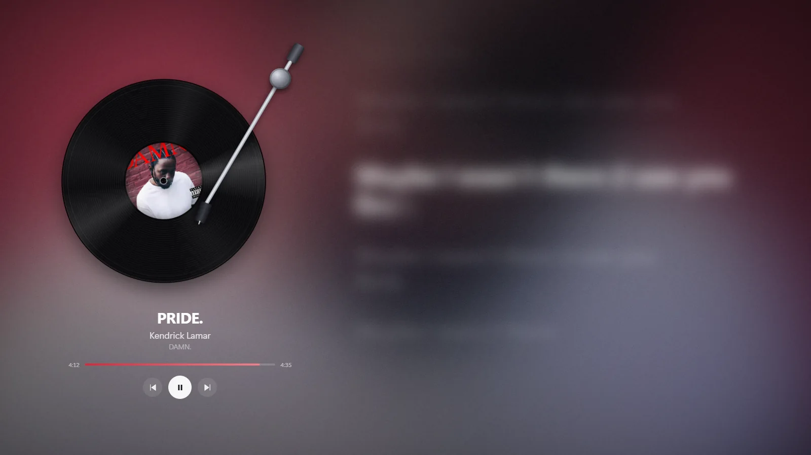
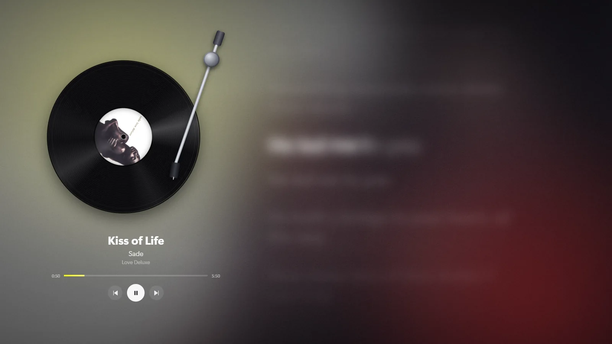
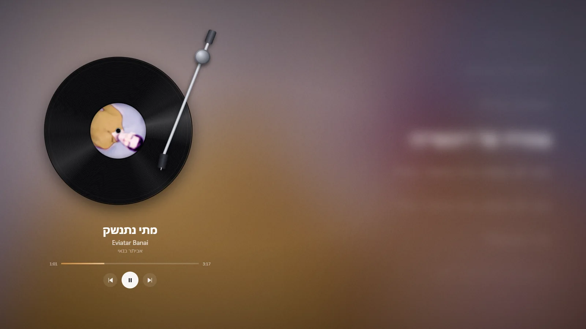
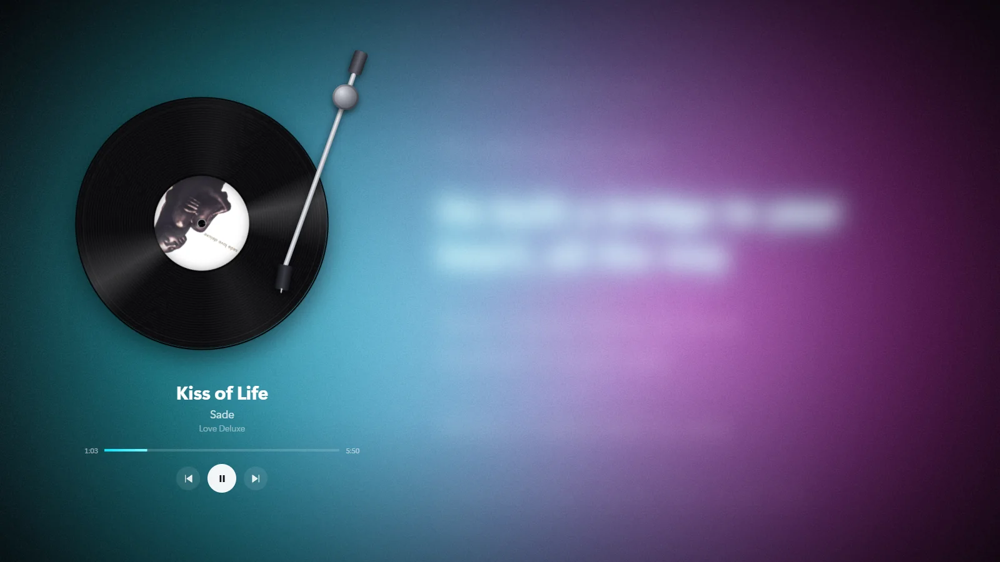
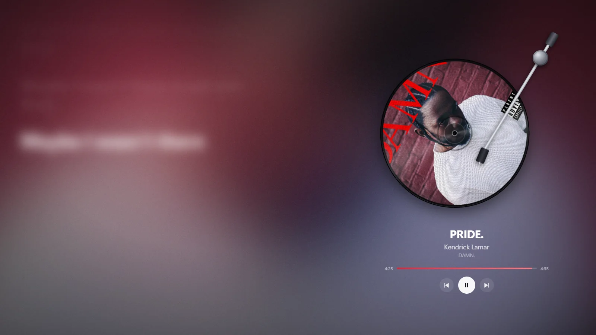
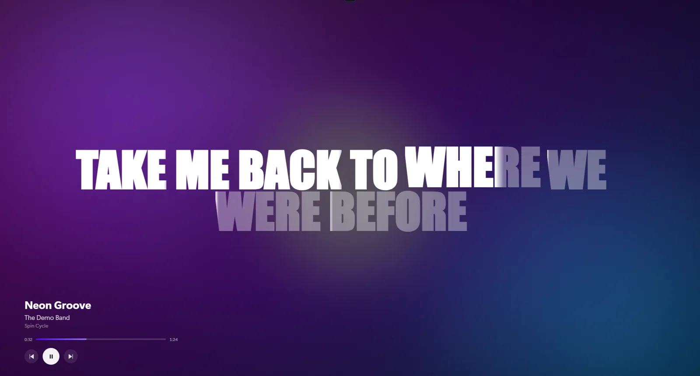
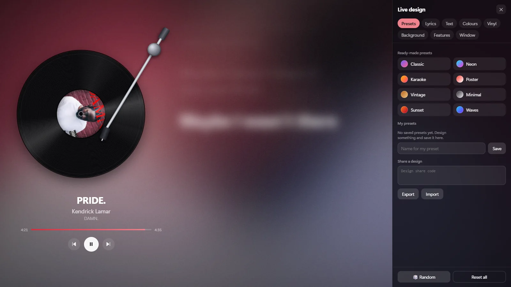
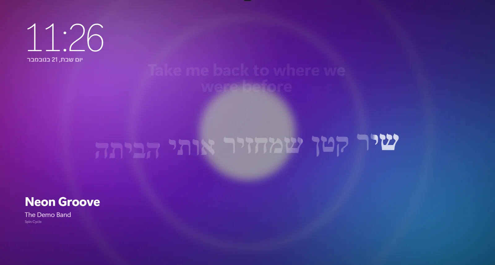
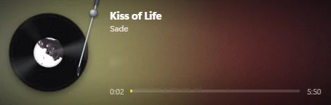

# Needledrop

**A spinning vinyl and word-by-word lyrics for Apple Music and Spotify on Windows 11.**
A companion window that turns whatever is playing into a living turntable: the record spins with the album cover as its label, the tonearm follows the song, the background takes its colours from the artwork, and the lyrics light up word by word as they are sung.



*Real screenshots of the Apple Music edition. Lyrics are blurred in all of them because they belong to their writers; in the app they are sharp.*

**Website:** [needledrop-music.netlify.app](https://needledrop-music.netlify.app/) · *(עברית בהמשך · [עבור לעברית](#עברית))*

---

## Two editions, one codebase

| | Needledrop for Apple Music | Needledrop for Spotify |
|---|---|---|
| **Status** | Tested against the live Apple Music app | **Beta: not yet tested against a live Spotify session** |
| **Download** | [Needledrop-for-Apple-Music-win-x64.zip](https://github.com/ndvepic/needledrop/releases/latest/download/Needledrop-for-Apple-Music-win-x64.zip) | [Needledrop-for-Spotify-win-x64.zip](https://github.com/ndvepic/needledrop/releases/download/spotify-beta-2/Needledrop-for-Spotify-win-x64.zip) |
| **App name** | Needledrop for Apple Music | Needledrop for Spotify |
| **Show / hide hotkey** | `Ctrl` `Alt` `L` | `Ctrl` `Alt` `K` |
| **Starting lyric offset** | +1.5 s (tuned on real songs) | 0 s (not calibrated) |

The editions are built to run side by side: each has its own name, icon, hotkey, settings folder and installer entry. Everything they differ in is in one file, [`lib/editions.js`](lib/editions.js).

**Needledrop for Spotify** is built for **Spotify Premium** (there is no special handling for ads). What has been checked: it starts, shows its waiting screen, runs the built-in demo, ignores other players, and its installer works. What has **not** been checked: that it picks up a real Spotify song, cover art, lyric timing, and seeking. If you try it, please [open an issue](https://github.com/ndvepic/needledrop/issues) with what you see.

> Needledrop is an independent project. It is not affiliated with, endorsed by or sponsored by Apple Inc. or Spotify AB. "Apple Music" is a trademark of Apple Inc. and "Spotify" is a trademark of Spotify AB; both are used here only to say which apps Needledrop works with. Album artwork, song titles and artist names in the screenshots belong to their respective owners.

## How it connects

Both editions read what the player already publishes to Windows (the media session that powers the system volume flyout), so they work next to the real app with no hack, no account, no login and no developer key.

## Highlights

| | |
|---|---|
| **Real vinyl** | The cover is the record's label (or the whole disc in *picture disc* mode). Eased spin-up and spin-down, a tonearm that lifts on pause and tracks the song's progress, 3D tilt that follows the mouse. |
| **Word-by-word lyrics** | Synced lyrics from [LRCLIB](https://lrclib.net), with true per-word timing when available and estimated word timing otherwise. Five singing effects (fill, pop, neon, shimmer, wave), five entrances, three layouts (scroll, focus, poster). Full right-to-left support and Hebrew fonts. |
| **Live design panel** | Press **S**. Fonts, size, weight, colours (from the cover or custom), glow, background, vinyl, layout. Eight presets, your own saved presets, share-codes to import/export a look, and a dice button. |
| **Reacts to the music** | Background and record pulse with the bass, with an optional equaliser. The system audio is analysed locally in the window; nothing is recorded, played back or sent anywhere. |
| **Playback controls** | Previous / play-pause / next from the window or keyboard. |
| **Widget mode** | **W** shrinks it into a small always-on-top card with the current line. |
| **Screensaver** | After a few idle minutes: a big clock, the slowly drifting cover and the current line in poster size. |
| **Yours to tune** | Per-song lyric sync (`[` `]`, `Shift` for whole seconds), drop an `.lrc` / `.txt` on the window to set a song's lyrics, one-click lyric reload. |
| **Record swap** | New song? The old record slides out and the new one slides in. |
| **Tray + hotkey** | Tray icon with a menu (widget, always-on-top, launch at Windows startup) and a global show / hide hotkey. |

## Screenshots

<table>
<tr>
<td><br><sub>Colours from the cover</sub></td>
<td><br><sub>Hebrew, right to left</sub></td>
</tr>
<tr>
<td><br><sub>Neon preset</sub></td>
<td><br><sub>Picture disc</sub></td>
</tr>
<tr>
<td><br><sub>Poster layout</sub></td>
<td><br><sub>Design panel</sub></td>
</tr>
<tr>
<td><br><sub>Screensaver</sub></td>
<td><br><sub>Widget</sub></td>
</tr>
</table>

## Install

Requirements: Windows 11 (Windows 10 is not tested), and the Apple Music app from the Microsoft Store or the Spotify desktop app.

Download your edition from the table above, unzip, then double-click **`Install.cmd`**: it installs for the current user (no administrator rights), adds Start Menu and Desktop shortcuts and registers the app in *Settings → Apps*, where it can be uninstalled normally (settings and the lyrics cache are kept). Or skip installing and just run the `.exe` from the unzipped folder.

> The builds are not code-signed, so Windows SmartScreen may show an "unknown publisher" notice the first time. Choose *More info → Run anyway*.

## Keyboard

| Key | Action |
|---|---|
| `S` | Design panel (`Esc` closes it) |
| `R` | Random design |
| `F` / `F11` | Fullscreen |
| `W` | Widget mode |
| `Ctrl` `Alt` `L` / `K` | Show / hide the window from any app (for Apple Music / for Spotify) |
| `P` | Always on top |
| `V` | Classic vinyl ↔ picture disc |
| `Space` / `N` / `B` | Play-pause / next / previous |
| `[` `]` | Shift this song's lyric sync by 0.25 s (`Shift` = 1 s) |
| `+` `-` `0` | Lyric size / reset |

## How it works

```
Apple Music or Spotify ─► Windows media session (SMTC)
                              │
             media-reader.ps1 ┘  (Windows PowerShell 5.1: title, artist, cover, position, capabilities)
                              ▼
                         main.js  ── lib/lyrics.js ──► LRCLIB (lyrics lookup, cached locally)
                              │      media-control.ps1 ◄── play / pause / next / previous
                              ▼
                      renderer/  (vinyl, tonearm, word-synced lyrics, design panel, audio analysis)
```

* `media-reader.ps1` polls the chosen player's session about 2.5 times a second. Every sample is time-stamped and the window compensates for the time spent in the pipe.
* `lib/lyrics.js` is pure logic (LRC and word-level parsing, matching, instrumental handling) and is unit-tested.
* The window animates from a single clock, so lyrics, vinyl, tonearm and progress never drift apart.

## Honest limitations

* **Apple Music edition: seeking is not possible.** Apple Music for Windows does not let other apps seek: it reports `seek` as unsupported and ignores the command (verified on a live session). The UI hides the seek affordances automatically. For Spotify, seeking turns on only if Spotify reports that it is allowed; this has not been tested.
* **Lyrics come from LRCLIB**, a community source. Rare songs may have none, and timings can differ from your player's own; use `[` `]` or the sync slider.
* Each edition follows only its own player.
* **Audio reactivity** uses Windows' output loopback. Windows may briefly show a capture indicator on some systems.

## Privacy

To find lyrics the app sends the song title, artist, album and duration to `lrclib.net`, and nothing else. No accounts, no analytics, no tracking. Audio is analysed in memory and discarded. Settings and a lyrics cache live in your user profile (`%APPDATA%\needledrop-apple-music` or `%APPDATA%\needledrop-spotify`; if you used an earlier version, its folder is kept).

## Development

Needs [Node.js](https://nodejs.org) 20+.

| Command | What it does |
|---|---|
| `npm start` / `npm run start:spotify` | Run an edition from source |
| `npm run demo` / `npm run demo:spotify` | Run with a built-in made-up song, so no player is needed |
| `npm test` | Unit tests: lyrics logic and the edition definitions |
| `npm run icon` | Regenerate the icons from `build/*.svg` |
| `npm run dist` | Test, then package and zip both editions (`dist:apple` / `dist:spotify` for one) |

A screenshot runner is built in for visual checks: `electron . --win-size=1600x900 --user-data-dir=<tmp> --shots=<dir> --shot-plan=<plan.json>`, where the plan is a list of `{at, js, jsAt, name, log}` steps. Use a throw-away `--user-data-dir` so test settings never touch yours.

## Project layout

```
lib/editions.js      the only place the two editions differ
lib/lyrics.js        lyrics parsing + LRCLIB lookup (tested)
main.js              window, media reader/control processes, lyrics cache, IPC
preload.js           the small, whitelisted bridge between window and main process
media-reader.ps1     reads the player's media session
media-control.ps1    sends play / pause / next / previous
renderer/            UI: app.js (engine), settings.js (live design panel), style.css
tools/               build.js (packaging), make-icon.js
installer/           per-user install / uninstall scripts
site/                the website (static) and the screenshots used here
test/  build/        unit tests, icons
```

---

<a id="עברית"></a>

# עברית

**תקליט ויניל מסתובב ומילים שנדלקות מילה אחרי מילה, ל-Apple Music ול-Spotify ב-Windows 11.**

חלון נלווה שהופך את מה שמתנגן לפטיפון חי: העטיפה היא תווית התקליט, הזרוע עוקבת אחרי השיר, הרקע לוקח את הצבעים מהעטיפה, והמילים מתמלאות בצבע כשהן מושרות.

| | Needledrop for Apple Music | Needledrop for Spotify |
|---|---|---|
| **מצב** | נבדקה מול Apple Music אמיתית | **בטא: עוד לא נבדקה מול Spotify אמיתית** |
| **הורדה** | [Needledrop for Apple Music](https://github.com/ndvepic/needledrop/releases/latest/download/Needledrop-for-Apple-Music-win-x64.zip) | [Needledrop for Spotify](https://github.com/ndvepic/needledrop/releases/download/spotify-beta-2/Needledrop-for-Spotify-win-x64.zip) |
| **קיצור גלובלי** | `Ctrl+Alt+L` | `Ctrl+Alt+K` |

### מה יש בפנים
* **ויניל אמיתי:** תקליט קלאסי או תקליט תמונה, האצה והאטה חלקות, זרוע שעולה בהשהיה, והטיית תלת-ממד שעוקבת אחרי העכבר.
* **מילים מילה-אחר-מילה** מ-LRCLIB, בתמיכה מלאה בעברית ובימין-לשמאל, עם 17 גופנים.
* **פאנל עיצוב חי** (`S`): אפקטי שירה, פריסות, צבעים, גופנים, רקע, ערכות מוכנות, ערכות אישיות ושיתוף עיצוב בקוד.
* **תגובה למוזיקה**, **בקרת נגן**, **מצב וידג'ט** (`W`), **שומר מסך** ו**החלפת תקליט מונפשת**.
* **כיוונון:** סנכרון מילים לכל שיר (`[` `]`), וגרירת קובץ `.lrc` או `.txt` לחלון.

### התקנה
מורידים את הגרסה המתאימה, מחלצים, ולוחצים פעמיים על `Install.cmd`.

### מגבלות, בכנות
* **ב-Apple Music אי אפשר לדלג בתוך השיר** מבחוץ: היא מדווחת שזה לא נתמך ומתעלמת מהפקודה (נבדק מול סשן חי). ב-Spotify זה עוד לא נבדק.
* המילים מגיעות מ-LRCLIB (מקור קהילתי), ולכן התזמון עשוי להיות שונה מעט.
* **פרטיות:** לצורך מציאת מילים נשלחים ל-`lrclib.net` רק שם השיר, האמן, האלבום והאורך. אין חשבונות, ניתוח שימוש או מעקב.

רישיון: MIT.
